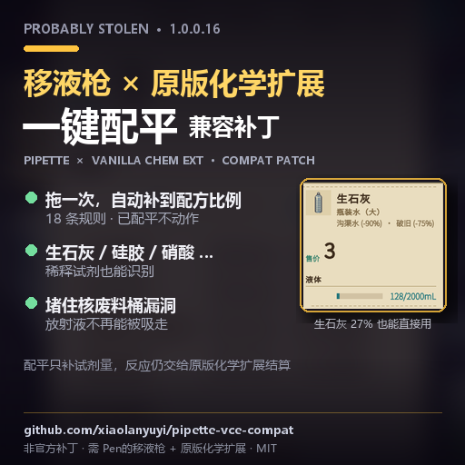
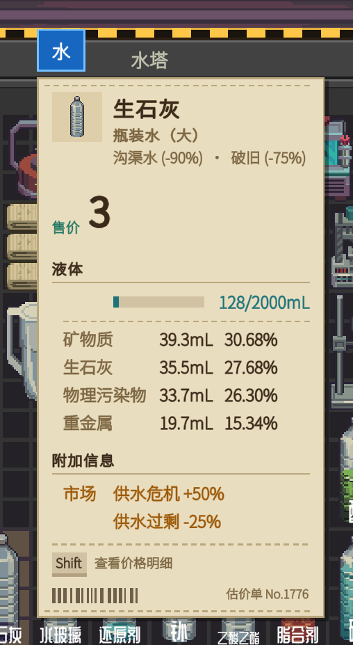

# 移液枪 × 原版化学扩展 兼容补丁（一键配平版）

> **Pipette × Vanilla Chem Ext Compat** — an unofficial compatibility patch for the game  
> **《深空当铺·可能是偷的》(Probably Stolen) 1.0.0.16（VERSION 100-Rev16）**

**Steam 创意工坊（已发布）：https://steamcommunity.com/sharedfiles/filedetails/?id=3846674523**



让 **Pen的移液枪**（超级移液枪 / 自动移液枪）给 **原版化学扩展 (Vanilla Chemistry Expansion)** 的配方做
**一键配平**：吸满试剂后拖到目标容器一次，自动把试剂补到配方要求的化学计量比；已经配平就不动作、不过量。
反应本身仍由原版化学扩展自己的每秒/夜间结算完成，不跳过它的化学。

同时修复一个漏洞：**移液枪不能再从撬开的核废料桶里把放射性液体吸走**。

---

## 兼容版本

| 项目 | 版本 |
|---|---|
| 游戏 | 深空当铺·可能是偷的（Probably Stolen）**1.0.0.16（VERSION 100-Rev16）** |
| 前置 mod 1 | **Pen的移液枪 / Pen_mod_pipette 1.1.5**（创意工坊 3829409725） |
| 前置 mod 2 | **原版化学扩展 / Vanilla Chemistry Expansion 1.11.1**（创意工坊 3832077837） |
| 本补丁 | **2.0.1**（创意工坊版与 Releases 内容一致） |

两个前置 mod 的作者更新后，若改了移液枪的交互入口，桶守卫会自动跳过（日志有 Warn），**配平规则不受影响**。

---

## 功能

### 1）18 条配平规则（7 个自动模式 + 11 条内置模式追加）

**新增 7 个 hydra 模式**（枪里吸满对应液体后自动进入该模式）：

| 枪内液体 | 目标里已有 | 自动配平到 |
|---|---|---|
| 生石灰 `vce_quicklime` | 含化学污染物的碱 | 生石灰 = 污染物 ×1（苛化 1:1） |
| 硅胶 `vce_silica_gel` | 酸 + 化学污染物 | 硅胶 = 污染物 ×1/4（脱氟 1:4） |
| 硝酸 `vce_nitric_acid` | 甲苯 | 硝酸 = 甲苯 ×3（硝化 1:3） |
| 乙酸 `ia_acetic_acid` | 酒精 | 乙酸 = 酒精 ×1（酯化 1:1） |
| 梦帽萃取液 `dream_cap_extract` | 梦魇帽萃取液 | 1:1（梦魔菌毒素） |
| 水玻璃 `vce_water_glass` | 放射性液体 | 水玻璃 = 放射性总量 ×1（玻璃固化） |
| 乙酸乙酯 `ia_ethyl_acetate` | 裂变产物 | 乙酸乙酯 = 裂变产物 ×2（钚萃取） |

**内置酸/碱/酒精/还原剂模式追加 11 条**：

| 枪内 | 目标 | 自动配平到 |
|---|---|---|
| 原版酸 | 梦帽+梦魇萃取液 | 酸 ≈ 萃取液总量 ×2.5%（梦毒要求 0.5–5%） |
| 原版酸 | 生物碱 | 酸 = 生物碱 ×10%（快克因成盐，含水 >1% 不动作） |
| 原版酸 | 水玻璃 | 酸 = 水玻璃 ×1（析出硅胶） |
| 原版酸 | 甲苯 + 硝酸 | 酸 ≈ 总量 ×10%（硝化催化） |
| 原版酸 | 酒精 + 乙酸 | 酸 ≈ 总量 ×1%（酯化催化） |
| 原版酸 | 核废料桶废燃料 | 酸 = 废燃料 ×1（溶解） |
| 原版碱 | 石英 | 碱 = 石英 ×1（制水玻璃） |
| 原版碱 | 硝酸 / 乙酸 | 碱 = 底物 ×1（中和） |
| 酒精 | 辣椒素 | 酒精 = 辣椒素 ×4（失能剂辣酯） |
| 还原剂 | 溶解钚 | 还原剂 = 溶解钚 ×10（钚萃取） |

> 机制：全部使用移液枪内置的 `topup`（`conversion:false`）配平逻辑——和它原本的「酒精补平 / 脂键补平」同一套。
> 一次没加完（枪容量 100 mL）就再拖一次，每次只补"还差的量"；已经配平时提示「已达配平」且**不会倒液**。

### 2）核废料桶守卫

原版化学扩展用拦截 `WaterHelper.TransferLiquid` 的方式禁止撬开的核废料桶（`nc.opened_waste`）里的液体离开；
而移液枪从不走这条函数（它自己改液体 tag），所以原本可以直接把废燃料 / 溶解钚 / 裂变产物吸走。
本补丁 hook 移液枪的 `OnTarget`：**吸取方向**会把不该离开的液体原样放回；**往桶里倒试剂不受影响**
（溶解、还原、萃取、玻璃固化照常）。

---

## 安装

1. 订阅并启用两个前置 mod：
   - [Pen的移液枪](https://steamcommunity.com/sharedfiles/filedetails/?id=3829409725)
   - [原版化学扩展](https://steamcommunity.com/sharedfiles/filedetails/?id=3832077837)
2. 安装本补丁（二选一）：
   - **Steam 创意工坊**：在工坊订阅本补丁，Steam 下载后到游戏内 MOD 列表启用；
   - **本地安装**：下载本仓库 [Releases](https://github.com/xiaolanyuyi/pipette-vce-compat/releases) 里的 zip，解压出
   `pipette_vce_compat` 文件夹，整个放进：
   ```
   <Steam>\steamapps\common\Probably Stolen\Mods\pipette_vce_compat\
   ```
   （也可以直接 clone 本仓库，把 `mod\` 文件夹改名为 `pipette_vce_compat` 放进 `Mods\`。）
3. 进入游戏 → MOD 列表，启用 **移液枪 × 原版化学扩展 兼容补丁**（它会自动检查两个前置）。
4. 日志确认（Player.log）：
   - `pipette rules loaded: 18`（内置 11 + 本补丁 7 个模式）
   - 11 行 `pipette patch applied mode=... from=pipette_vce_compat`
   - 进入游戏后出现 `[pipette-vce-compat] hooked PenPipette.PipetteTransfer.OnTarget`
     （桶守卫在"所有模组登记完成"后才安装，启动早期出现 `enabled (guard will hook after ...)` 是正常的）

> 卸载：删掉 `Mods\pipette_vce_compat` 文件夹即可；若存档里的移液枪已经记录了本补丁的模式，
> 移液枪会退化成"不反应、倒空后恢复"，不会坏档。

---

## 使用要点

1. **先放底物，再拖试剂**：配平比例是相对目标里已有底物算的。
2. **催化酸有先后**：硝化先加硝酸（≥3×甲苯）再拖酸；酯化先加乙酸再拖酸。顺序反了再拖一次就会补正。
3. **核废料顺序**：浓酸（VCE 要求酸占非放射性液体 ≥98%，所以先加酸）→ 还原剂 → 乙酸乙酯 → 加热后补水玻璃固化。
4. **枪容量 100 mL**：大体积（比如核废料桶要 500 mL 酸）要拖几次，每次只补差额。
5. 只想要自由加任意体积时用**普通移液枪**；只有超级移液枪会走配平规则。

---

## 常见问题：生石灰纯度到不了 50%？



**游戏里没法把生石灰和矿物质/物理污染物分开**，所以矿石路线的生石灰必然 <50%：

- 矿石粉碎组成固定：方解石 ~12–15 mL、石英 ~14–17、矿物质 ~6–8、重金属 ~4–5.5、物理污染物 ~4–6。
- 滤芯只有两种孔径：Kotton 150（只拦粒径 ≥150 的石英/碎屑）、水滤芯 22（拦粒径 ≥22 的固体）。
- 粒径：方解石/生石灰/碳酸钙/硅胶/物理污染物 =100、石英=200、矿物质=30、重金属=12、酸碱=5。
  → 水滤芯孔径 22 会连**生石灰自己**一起滤掉，Kotton 只滤石英，中间没有孔径能"只留生石灰"。
- 煅烧只把方解石变生石灰并损失约 45% 体积 → 矿石路线生石灰占比通常就是 **25–30%**。

**补丁怎么处理**：把配平模式的检测阈值降到稀释试剂也能用（生石灰 12%、硅胶/硝酸/乙酸 15%、梦帽萃取液 20%、
乙酸乙酯 25%、水玻璃 30%），并把新模式优先级降到 65（内置酸/碱/酒精/矿物质模式 70–110，优先走内置）。

**代价**：移液枪是按比例吸液的，所以杂质会跟着进目标容器。用 VCE 标准流程收尾即可——
苛化后用水滤芯（22）过滤碱：矿物质、物理污染物、剩余生石灰、碳酸钙、碎屑都会被滤掉，重金属靠碱沉降。
注意稀释试剂会把碱稀释，苛化要求碱占总液量 ≥50%，必要时先加碱或先滤杂质。

---

## 发布到创意工坊（维护者）

游戏没有内置上传按钮，创意工坊物品用 Valve 的 `steamcmd` 上传（社区官方模组指南的推荐方式）。本仓库已备好：

- `workshop/pipette_vce_compat.vdf` — 物品描述文件模板（`appid 4348910`，`publishedfileid 0` 表示新建）
- `workshop/description.bbcode` — 可直接粘贴到创意工坊页面的富文本描述（中英双语）
- `workshop/PUBLISHING.md` — 完整步骤：首次上传、法律协议、标签、可见性、更新流程、验收清单

快速开始：

```powershell
steamcmd +login <你的Steam账号> +workshop_build_item "E:\knowledge base\pipette-vce-compat\workshop\pipette_vce_compat.vdf" +quit
```

上传成功后 steamcmd 会把新物品 id 回写到 VDF；之后原样再跑一次就是更新。

## 从源码构建

需要 [.NET SDK](https://dotnet.microsoft.com/download)（本项目用 netstandard2.1，dotnet 6+ 均可编译）。

```powershell
# 自动探测 Steam 库；找不到就显式指定游戏 Managed 目录
.\build.ps1
.\build.ps1 -GameManagedDir "D:\SteamLibrary\steamapps\common\Probably Stolen\Probably Stolen_Data\Managed"
```

产物会复制到 `mod\PipetteVceCompat.dll`。也可以直接：

```bash
dotnet build -c Release -p:GameManagedDir="<Steam>/steamapps/common/Probably Stolen/Probably Stolen_Data/Managed"
```

构建只引用游戏自带的 `Assembly-CSharp.dll` / `0Harmony.dll` / `UnityEngine.CoreModule.dll`，
不引用、不包含两个前置 mod 的任何文件或二进制。

---

## 目录结构

```
mod/                        可直接放进 Mods\pipette_vce_compat\ 的发布内容
  manifest.xml
  PipetteVceCompat.dll      载体 + 核废料桶守卫
  PipetteReactions.json     18 条配平规则（纯数据）
  Localization/             zh / zh-Hans / zh-CN / en
  optional/
    instant-reactions.json  可选的"瞬间反应版"规则（覆盖根目录同名文件即切换）
  README.md                 游戏内视角的说明（安装/自检/限制）
src/PipetteVceCompat/       补丁源码（C#）
docs/                       文档与截图
build.ps1                   一键构建脚本
```

---

## 已知限制

- 只做**液体配方**的配平。机器内结算的配方（电解、蒸馏、HPLC、分液漏斗、复装机、化学制剂成型机）不适用：
  成型机是"绝对体积阈值"（如注射剂 ≥5000 µL），topup 只能调比例；发酵水解的酸是"占总液量 ≥0.5%"，也不适合按底物比例算。
- 稀释试剂会带杂质（见上），需要末端过滤；这是移液枪按比例吸液的机制决定的。
- 移液枪的 hydra 反应/配平路径不混温、不过滤（移液枪固有行为），容器价格/水质标签可能延后一 tick 刷新。
- 本补丁不处理：钚液体直接倒进酒瓶不会加"核子饮料"标记（VCE 只给"用钚安瓿扎酒"加）。
- 非官方补丁，不保证与将来版本的移液枪/原版化学扩展兼容；若作者更新后失效，欢迎提 issue。
- 创意工坊版与 Releases 内容一致；同一 Mod ID 的本地副本会优先于工坊副本（方便自己测试新版本）。
- `<GameVersions>` 写的是 `1.0.0`（覆盖 1.0.0.16）。旧编号 `0.46D` 在 1.0 之后会被游戏当作"pre-1.0 numbering"忽略。

---

## Credits

- **Pen的移液枪 / Pen_mod_pipette** — 作者 **Pen**（创意工坊 3829409725）。本补丁通过其公开的
  `PipetteReactions.json` 扩展点工作，并调用其公开类型做交互拦截。
- **原版化学扩展 / Vanilla Chemistry Expansion** — 作者 **gdm56**（创意工坊 3832077837）。本补丁按其配方比例做配平，
  不包含其任何文件。
- 游戏《深空当铺·可能是偷的》及其素材版权归 Questing Goose Studio 所有。

## License

代码与规则文本采用 [MIT License](LICENSE)。第三方 mod 与游戏资产不包含在本仓库内，版权归各自作者。